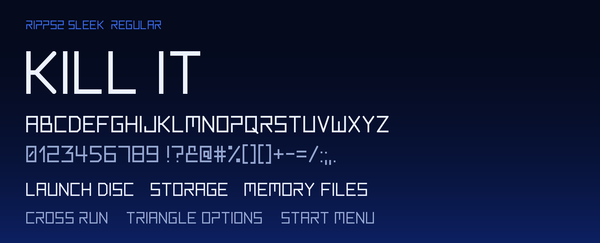
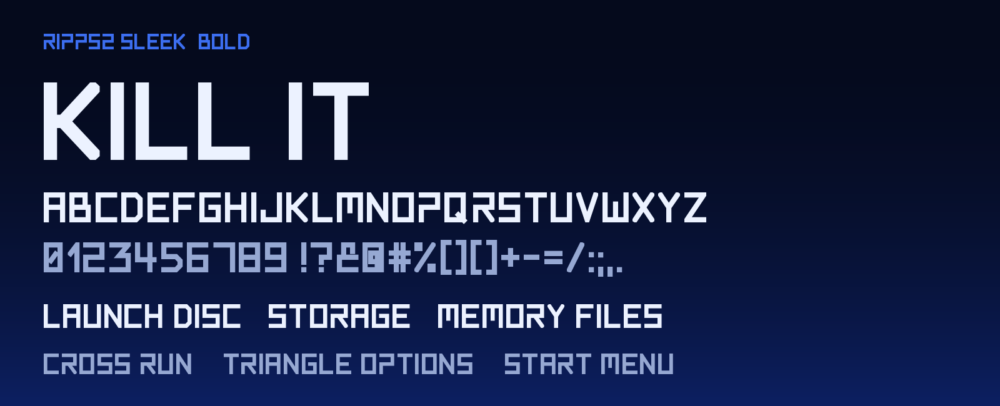
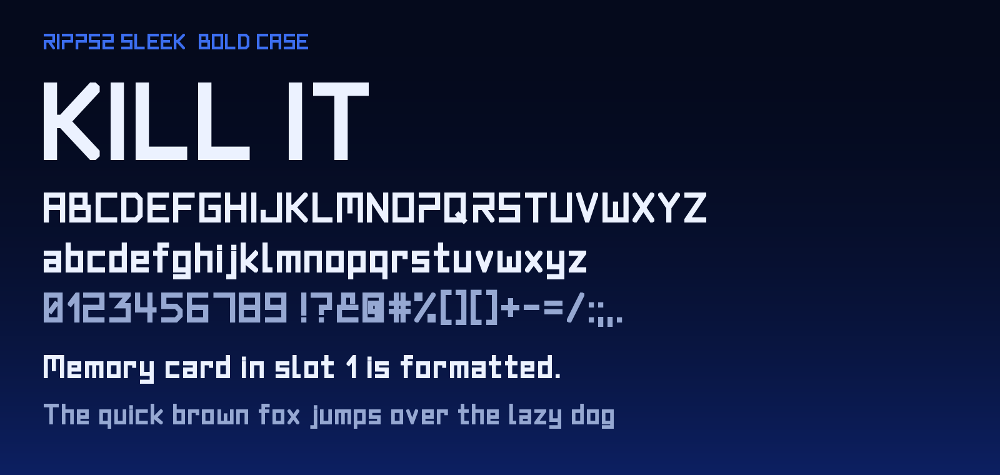

<!-- i18n: the language bar, made by ps2-pillars tools/readme-i18n -->
<p align="center">
  <a href="README.md">English</a> |
  <a href="README.es.md">Español</a> |
  <a href="README.pt-BR.md">Português (Brasil)</a> |
  <a href="README.pt.md">Português</a> |
  <a href="README.fr.md">Français</a> |
  <a href="README.de.md">Deutsch</a> |
  <a href="README.it.md">Italiano</a> |
  <a href="README.nl.md">Nederlands</a> |
  <a href="README.da.md">Dansk</a> |
  <a href="README.sv.md">Svenska</a> |
  <a href="README.pl.md">Polski</a> |
  <a href="README.cs.md">Čeština</a> |
  <a href="README.hr.md">Hrvatski</a> |
  <a href="README.sr.md">Srpski</a> |
  <a href="README.bg.md">Български</a> |
  <a href="README.ru.md">Русский</a> |
  <a href="README.el.md">Ελληνικά</a> |
  <a href="README.hu.md">Magyar</a> |
  <a href="README.ro.md">Română</a> |
  <a href="README.gl.md">Galego</a> |
  <a href="README.sq.md">Shqip</a> |
  <a href="README.tr.md">Türkçe</a> |
  <a href="README.ar.md">العربية</a> |
  <a href="README.fa.md">فارسی</a> |
  <a href="README.ja.md">日本語</a> |
  <a href="README.ko.md">한국어</a> |
  <a href="README.zh-CN.md">简体中文</a> |
  <a href="README.zh-TW.md">繁體中文</a> |
  <a href="README.vi.md">Tiếng Việt</a> |
  <a href="README.lo.md">ລາວ</a> |
  <b>Bahasa Indonesia</b> |
  <a href="README.fil.md">Filipino</a> |
  <a href="README.ceb.md">Cebuano</a>
</p>
<!-- /i18n -->

<p align="center"><sub>Terjemahan README bahasa Inggris; jika berbeda, yang berlaku bahasa Inggris. <a href="README.md">English</a></sub></p>

<p align="center"><sub><a href="https://github.com/akilluminati47/RIPPS2">RIPPS2</a> &nbsp;&middot;&nbsp; <a href="https://github.com/akilluminati47/RIPPS2/releases/latest/download/RIPPS2.elf">Unduh</a> &nbsp;&middot;&nbsp; <a href="https://github.com/akilluminati47/BIBLE">BIBLE</a> &nbsp;&middot;&nbsp; <a href="https://github.com/akilluminati47/RIPPS2-themes">Tema</a> &nbsp;&middot;&nbsp; <a href="https://github.com/akilluminati47/RIPPCSX2">RIPPCSX2</a> &nbsp;&middot;&nbsp; <b>Fon</b> &nbsp;&middot;&nbsp; <a href="https://akilluminati47.github.io/RIPPS2/">Situs</a> &nbsp;&middot;&nbsp; <a href="https://www.psx-place.com/threads/ripps2-a-ps2-front-end-in-one-elf-launch-disc-storage-memory-files.51316/">psx-place</a> &nbsp;&middot;&nbsp; <a href="https://discord.gg/Z7m9u5kby">Discord</a></sub></p>


# RIPPS2 Sleek

[](LICENSE-OFL)
[](LICENSE-MIT)
[](https://github.com/akilluminati47/RIPPS2-fonts/releases)
[](https://github.com/akilluminati47/RIPPS2)

Jenis huruf yang digambar untuk [RIPPS2](https://github.com/akilluminati47/RIPPS2), front end PS2: menunya, petunjuk tombol, pengaturan, kata tampilan yang menamai tiap daftar, dan setiap tema yang ingin tampak sebagai bagian darinya.

Hurufnya meniru tulisan logo PS2: satu goresan tipis dan rata, sudut persegi, huruf yang tersusun dari batang horizontal dan vertikal di atas kisi, serta bentuk terbuka logo itu sendiri (P tanpa batang di atas lengkungnya, angka 2 zig-zag). Hurufnya sempit, jadi satu baris penuh petunjuk tombol muat di layar 640 piksel.

| Potongan | Ketebalan | Huruf | Di RIPPS2 |
|---|---|---|---|
| **Regular** | goresan tipis | kapital (huruf kecil digambar kapital) | petunjuk, menu, pengaturan, nama sumber |
| **Bold** | goresan tebal | kapital | label di samping glif besar, kata tampilan, baris rilis |
| **Bold Case** | goresan tebal | huruf kecil asli | teks yang diketik, papan ketik layar, deskripsi |

## Pratinjau

### Regular



### Bold



### Bold Case



## Set karakter

Latin Dasar, Latin-1, dan Latin Diperluas A/B: 337 titik kode di setiap potongan. Untuk sementara huruf beraksen digambar sebagai huruf dasarnya. Daftar lengkap: [docs/charset.md](docs/charset.md).

## Unduh

Dari [Releases](https://github.com/akilluminati47/RIPPS2-fonts/releases), atau langsung dari repo ini:

| Format | Berkas |
|---|---|
| TTF | [fonts/ttf](fonts/ttf): `RIPPS2Sleek-Regular.ttf`, `RIPPS2Sleek-Bold.ttf`, `RIPPS2Sleek-BoldCase.ttf` |
| WOFF2 (web) | [fonts/woff2](fonts/woff2): tiga yang sama |

## Penggunaan

**Di tema RIPPS2** fon sudah ada di dalam `RIPPS2.elf`; cukup sebut namanya, tidak perlu mengirim apa pun:

```
default_font=builtin:ripps2sleek       # Regular
font3=builtin:ripps2sleekbold          # Bold
font1=builtin:ripps2sleekcase          # Bold Case
```

[RIPgrid](https://github.com/akilluminati47/RIPPS2-themes) seluruhnya disusun dengannya. Tema lain dari keluarga OPL mana pun bisa memakai TTF dari foldernya sendiri seperti fon lainnya.

**Di web:**

```css
@font-face { font-family: "RIPPS2 Sleek"; font-weight: 400; src: url("RIPPS2Sleek-Regular.woff2") format("woff2"); }
@font-face { font-family: "RIPPS2 Sleek"; font-weight: 700; src: url("RIPPS2Sleek-Bold.woff2") format("woff2"); }
@font-face { font-family: "RIPPS2 Sleek Case"; font-weight: 700; src: url("RIPPS2Sleek-BoldCase.woff2") format("woff2"); }
```

**Di PC:** pasang TTF seperti biasa. Regular dan Bold adalah satu keluarga, *RIPPS2 Sleek*; Bold Case adalah keluarga tersendiri, *RIPPS2 Sleek Case* (Bold), jadi keduanya tidak pernah bentrok.

## Membangun

Setiap glif adalah sekumpulan garis patah pada kisi setinggi enam satuan (tinggi kapital); masing-masing diberi goresan dan goresan-goresan itu disatukan menjadi satu garis luar yang bersih. Gambarnya ada di [tools/make_sleek_font.py](tools/make_sleek_font.py) (berkas yang sama tempat RIPPS2 membangun salinannya); [tools/build.py](tools/build.py) membuat semua yang ada di sini darinya dan memberi fon nama serta ketebalan yang dibaca aplikasi desktop dan peramban (RIPPS2 sendiri hanya membaca garis luarnya).

```
pip install -r requirements.txt
python tools/build.py
```

## Lisensi

- Fon: [SIL Open Font License 1.1](LICENSE-OFL). Pakai, sertakan, ubah; fon yang diubah memakai nama baru.
- Alat: [MIT](LICENSE-MIT).

Tidak ada di sini: Planet N Compact, huruf teks utama RIPPS2, milik [Iconian Fonts](https://www.iconian.com) dan tetap milik mereka; RIPPS2 One, tambalan satu glif untuk angka 1-nya, ikut bersamanya.

<p align="center"><sub><a href="https://github.com/akilluminati47/RIPPS2">RIPPS2</a> &nbsp;&middot;&nbsp; <a href="https://github.com/akilluminati47/RIPPS2/releases/latest/download/RIPPS2.elf">Unduh</a> &nbsp;&middot;&nbsp; <a href="https://github.com/akilluminati47/BIBLE">BIBLE</a> &nbsp;&middot;&nbsp; <a href="https://github.com/akilluminati47/RIPPS2-themes">Tema</a> &nbsp;&middot;&nbsp; <a href="https://github.com/akilluminati47/RIPPCSX2">RIPPCSX2</a> &nbsp;&middot;&nbsp; <b>Fon</b> &nbsp;&middot;&nbsp; <a href="https://akilluminati47.github.io/RIPPS2/">Situs</a> &nbsp;&middot;&nbsp; <a href="https://www.psx-place.com/threads/ripps2-a-ps2-front-end-in-one-elf-launch-disc-storage-memory-files.51316/">psx-place</a> &nbsp;&middot;&nbsp; <a href="https://discord.gg/Z7m9u5kby">Discord</a></sub></p>

